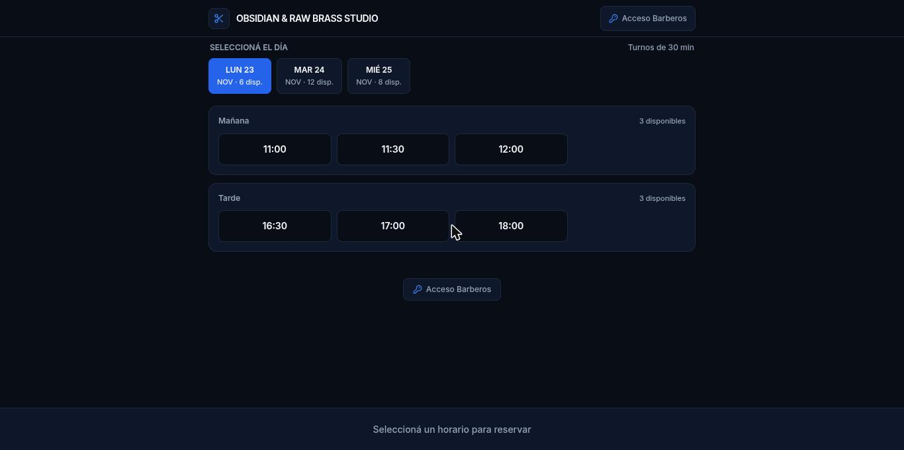
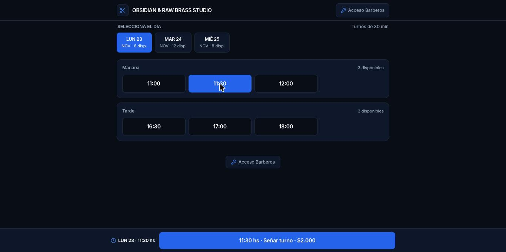
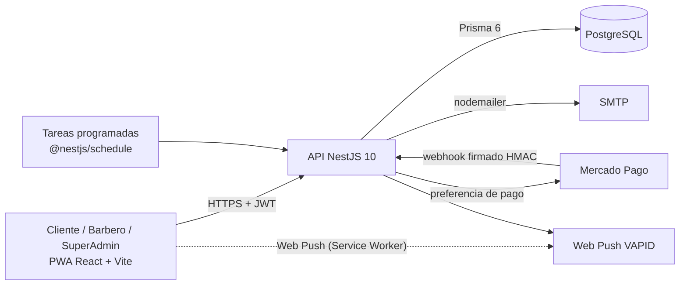
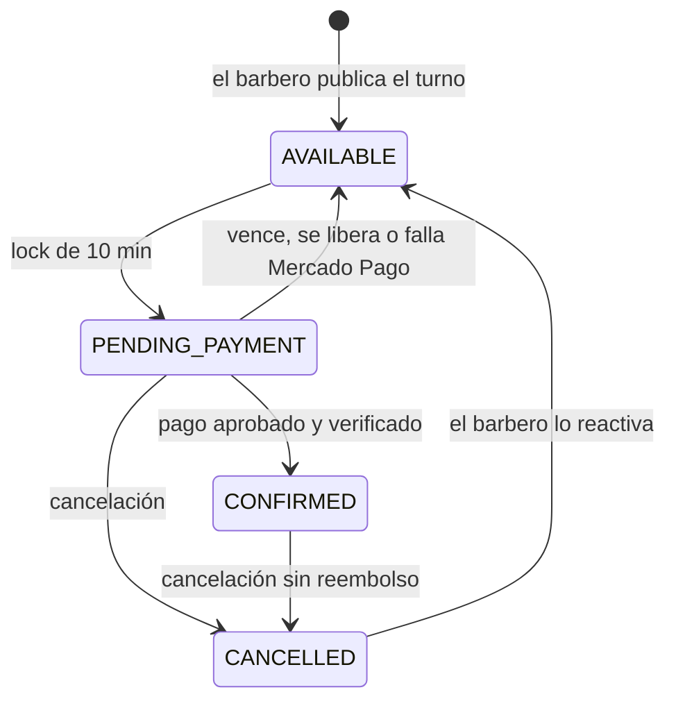

# Turnazo — Arquitectura, concurrencia y decisiones técnicas

Este documento complementa el [README](../README.md). Igual que él, solo describe lo que está implementado en el código: cada afirmación indica el archivo donde se puede verificar.

## Capturas

Agenda pública de una barbería (turnos de 30 minutos, agrupados por día y franja):

Al elegir un horario aparece la acción de señar el turno ($2.000 ARS):

Demo en vivo: https://turnero-barber.vercel.app

## Arquitectura

| Pieza | Dónde corre / se define | Archivo |
|---|---|---|
| Frontend (PWA) | Vercel: rewrite SPA y cabeceras de `sw.js` / `manifest.json` | `frontend/vercel.json` |
| API | Contenedor `node:24-alpine`, build multi-stage con `HEALTHCHECK` a `/health` | `backend/Dockerfile` |
| API + PostgreSQL | Manifiestos para un cluster local k3s (Deployment con probes, StatefulSet con volumen) | `k8s/` |
| CI | Validación de manifiestos de Kubernetes y escaneo de la imagen con Trivy | `.github/workflows/ci.yml` |
| Monitoreo | Prometheus + Alertmanager + Grafana con alertas por Telegram, desplegados aparte | `k8s/README.md` |
| Métricas | `GET /metrics` en formato Prometheus (apagado por defecto en producción, ver `METRICS_ENABLED`) | README, sección Variables de entorno |

## Ciclo de vida de un turno

Fuente de las transiciones: `backend/src/appointments/appointments.service.ts` y `backend/src/payments/payments.service.ts`.

## Concurrencia: cómo se evita el doble turno

El problema: dos clientes tocan el mismo horario al mismo tiempo. La solución no usa locks de aplicación ni colas: **cada transición de estado es un `updateMany` condicional en PostgreSQL**, y el resultado (`count`) dice si esa ejecución ganó.

1. **Reserva (`lockSlot`)**. Dentro de una transacción de Prisma se hace un `updateMany` que solo matchea si el turno está `AVAILABLE`, o `PENDING_PAYMENT` con `locked_until` vencido (o, con usuario autenticado, ya bloqueado por el mismo cliente). Si `count === 0`, otro cliente llegó primero y la API responde `409 Conflict`. El comentario del código lo llama *optimistic concurrency control en DB*. (`appointments.service.ts`)
2. **Checkout de invitado (`createPreferenceForSlot`)**. Mismo patrón, pero más estricto: no permite volver a bloquear un turno ya bloqueado por el mismo DNI, para que un tercero que conozca ese DNI no obtenga un token nuevo y libere el bloqueo ajeno. (`payments.service.ts`)
3. **Token de bloqueo**. Al bloquear se genera un `lockToken`; en la base solo se guarda su hash (`lock_token_hash`) y el token en claro se devuelve una única vez. Liberar el turno es otro `updateMany` condicional sobre ese hash: solo el titular puede hacerlo, y un intento con token incorrecto responde `403` y deja una línea de auditoría. (`appointments.service.ts` → `releaseSingleLock`, `lock-token.util.ts`)
4. **Rollback si falla Mercado Pago**. Si no se puede crear la preferencia de pago, el bloqueo se revierte de inmediato a `AVAILABLE`, también con un update condicional sobre el hash del token. (`appointments.service.ts`, `payments.service.ts`)
5. **Bloqueos vencidos**. `releaseExpiredLocks` devuelve a `AVAILABLE` los `PENDING_PAYMENT` con `locked_until` vencido. Se ejecuta al leer agendas y por cron. (`appointments.service.ts`, `appointments-cleanup.cron.ts`)
6. **Preferencias idempotentes**. La clave de idempotencia enviada a Mercado Pago combina el id del turno y el hash del bloqueo: reintentos del mismo bloqueo no duplican la preferencia, y un bloqueo nuevo nunca reutiliza la de uno anterior. (`payments.service.ts` → `createDepositPreference`)

### Confirmación de pago

Un pago aprobado nunca se toma por bueno sin verificarlo ni pisa el turno de otro cliente (`payments.service.ts`):

- **Verify-then-fetch**: en producción el estado del pago se consulta a la API de Mercado Pago y no se confía en el cuerpo del request. Se rechaza un monto menor a la seña.
- **Transacción con decisión explícita** (`decidePaymentConfirmation`), según el estado del turno:

| Estado del turno | Resultado |
|---|---|
| Ya tiene este `mp_payment_id` | Idempotente (`ALREADY_PROCESSED`) |
| Inexistente o `CANCELLED` | `OrphanPayment` |
| `CONFIRMED` con otro pago | `OrphanPayment` (`DUPLICATE_PAYMENT` o `SLOT_TAKEN_BY_OTHER_CLIENT`) |
| `PENDING_PAYMENT` del mismo cliente | Confirma |
| `PENDING_PAYMENT` de otro cliente con bloqueo vigente | `OrphanPayment` (`SLOT_TAKEN_BY_OTHER_CLIENT`) |
| `PENDING_PAYMENT` de otro cliente con bloqueo vencido, o `AVAILABLE` | Confirma y reasigna al cliente que pagó |

- **Update condicional** sobre exactamente el estado leído (`status`, `client_id`, `locked_until`). Si otro proceso modificó el turno en el medio, se lanza `ConcurrentSlotChangeError` y se reevalúa, hasta 5 intentos (`MAX_CONFIRMATION_ATTEMPTS`). Las colisiones por unicidad de `mp_payment_id` (error `P2002` de Prisma) también se reintentan.
- **Pagos huérfanos**: un pago aprobado que no puede asignarse queda registrado como `OrphanPayment` con estado `REQUIRES_REFUND`, en lugar de perderse o pisar otro turno.
- **Efectos secundarios una sola vez**: el email de confirmación se "reclama" con un `updateMany` sobre `confirmation_sent_at: null`, por lo que no se envía dos veces aunque lleguen el webhook y el retorno del pago a la vez.

### Cómo se prueba

La suite E2E corre contra un PostgreSQL embebido (PGlite), sin depender de una base externa, y cubre seguridad y concurrencia: 50 tests, además de 126 unitarios (ver el resumen en el README, sección Tests).

## Decisiones técnicas

| Decisión | Motivo | Dónde |
|---|---|---|
| Concurrencia con updates condicionales en la base, sin locks de aplicación | El estado correcto vive en PostgreSQL y no depende de la memoria de un proceso | `appointments.service.ts` |
| Guardar solo el hash del token de bloqueo | Una filtración de la base no permite liberar bloqueos ajenos | `lock-token.util.ts` |
| Verificar cada pago contra Mercado Pago y registrar huérfanos | Evita confirmar turnos con datos falsos o pisar reservas de otros | `payments.service.ts` |
| Seña no reembolsable por política | Cancelar nunca dispara un reembolso automático; la seña queda retenida y la política se devuelve en la respuesta | `appointments.service.ts` → `cancelAppointmentNoRefund` |
| Links de reserva firmados y `404` idéntico para "no existe" y "firma inválida" | Los ids de turno son visibles en la agenda pública: así no se pueden enumerar reservas ajenas | `appointments.service.ts`, `booking-link.service.ts` |
| Minimización de datos personales en artefactos públicos | La página de reserva y el `.ics` muestran solo el nombre de pila y datos enmascarados (DNI, id de pago) | `appointments.service.ts`, `pii-sanitizer.util.ts` |
| E2E con PGlite | Las pruebas de concurrencia corren en cualquier máquina y en CI, sin base externa | `backend/test/` |
| Credenciales del SuperAdmin obligatorias, sin valores por defecto | La API y el seed fallan si faltan o si siguen en el placeholder | `superadmin-credentials.util.ts` |
